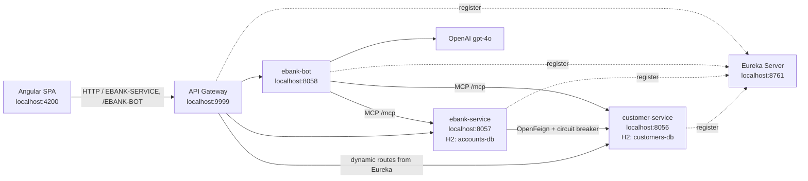
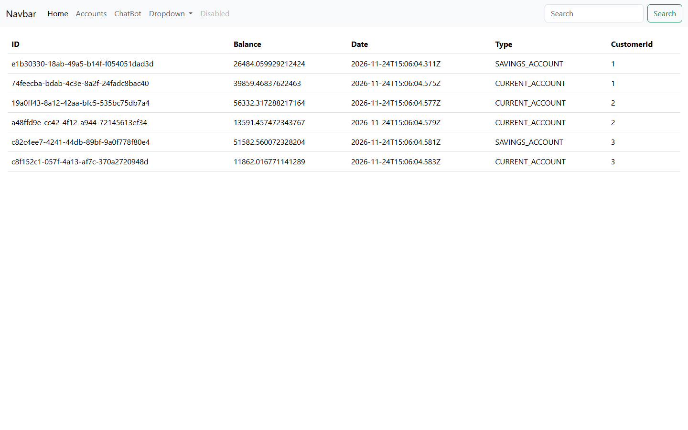
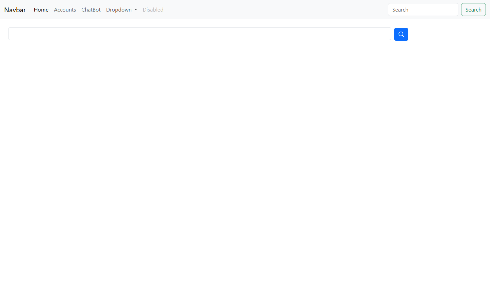
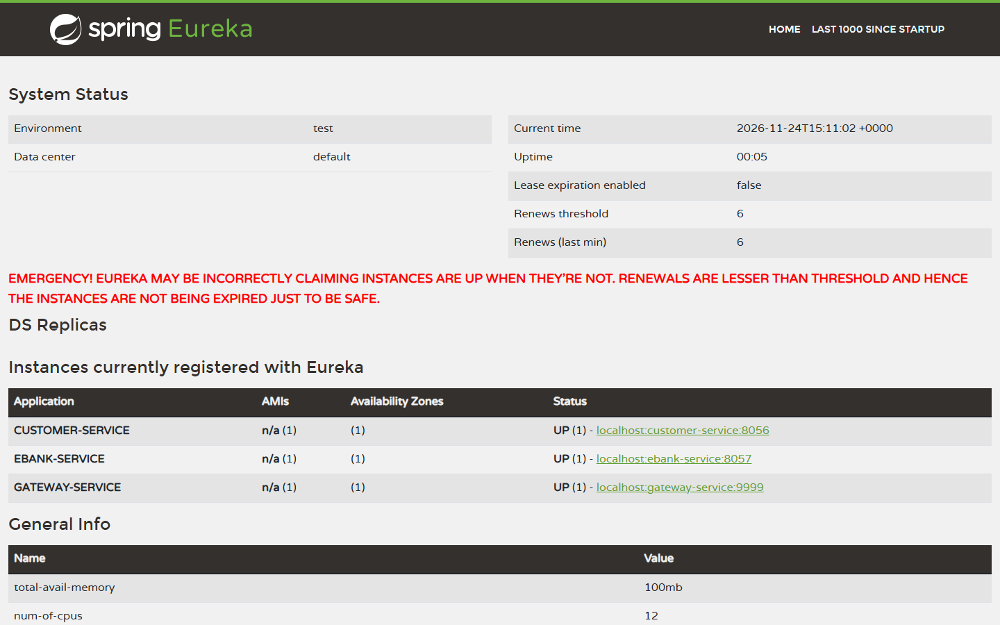
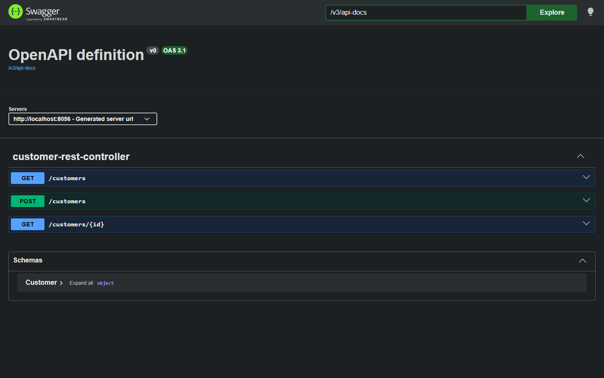
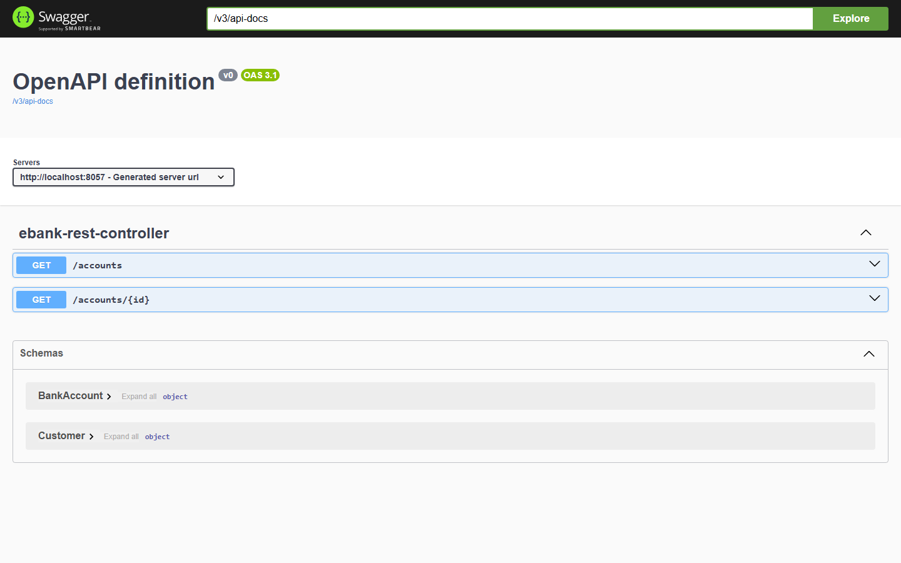

# EBank Microservices App

> A Spring Boot 4 / Spring Cloud microservices banking demo, backed by H2, exposed through an API gateway, consumed by an Angular SPA, and extended with an AI chatbot (Spring AI + MCP + OpenAI) available over REST, Telegram and Discord.

This repository is an educational JEE project (`tp-jee`) built incrementally as a Maven multi-module project. It demonstrates service discovery, API gateway routing, synchronous inter-service calls with OpenFeign + Resilience4j, MCP tool exposure, and streaming AI responses in the browser.

---

## Table of contents

- [Architecture](#architecture)
- [Tech stack](#tech-stack)
- [Services and ports](#services-and-ports)
- [Screenshots](#screenshots)
- [Prerequisites](#prerequisites)
- [Getting started](#getting-started)
- [API reference](#api-reference)
- [Data seeded at startup](#data-seeded-at-startup)
- [How the AI chatbot works](#how-the-ai-chatbot-works)
- [Testing](#testing)
- [Project structure](#project-structure)
- [Security and limitations](#security-and-limitations)
- [Known issues](#known-issues)
- [Possible improvements](#possible-improvements)

---

## Architecture



Request flow:

1. The Angular app calls the gateway on `http://localhost:9999` using uppercase Eureka service IDs (`/EBANK-SERVICE/...`, `/EBANK-BOT/...`).
2. The gateway uses Eureka's discovery locator to forward each request to the registered instance. No static routes are defined.
3. `ebank-service` enriches each account with customer data through a Feign client guarded by a Resilience4j circuit breaker and a `"Not Available"` fallback.
4. The chatbot calls the MCP servers exposed by `customer-service` and `ebank-service` to obtain live data for the LLM, and streams the answer back to the SPA.

---

## Tech stack

**Backend**

| Technology | Version / usage |
|---|---|
| Java | 21 |
| Spring Boot | 4.1.2 |
| Spring Cloud | 2025.1.4 (Netflix Eureka, Gateway, OpenFeign, Resilience4j) |
| Spring AI | 2.0.1 (ChatClient, ChatMemory, MCP server/client, OpenAI) |
| Spring Data JPA + H2 | in-memory databases, schema generated by JPA |
| Springdoc OpenAPI | Swagger UI on the data services and the bot |
| Lombok | DTO/entity boilerplate |
| Maven | wrapper `3.3.4` / Maven `3.10.0` |

**Frontend**

| Technology | Version / usage |
|---|---|
| Angular | 21.2.x (standalone components, signals, new control flow) |
| Bootstrap | 5.3 + Bootstrap Icons |
| ngx-markdown | renders streamed markdown chat answers |
| RxJS / HttpClient | API calls and streaming response events |
| Vitest | unit tests |

**Integrations:** Telegram long-polling bot, Discord bot, OpenAI `gpt-4o`.


---

## Services and ports

| Module | Spring application name | Port | Responsibility |
|---|---|---|---|
| `discovery-service` | `discover-service` | 8761 | Eureka service registry and dashboard |
| `customer-service` | `customer-service` | 8056 | Customer REST API, H2 `customers-db`, MCP server, Swagger UI |
| `ebank-service` | `ebank-service` | 8057 | Bank account REST API, H2 `accounts-db`, Feign client, MCP server, Swagger UI |
| `ebank-bot` | `ebank-bot` | 8058 | Streaming/non-streaming chat API, AI agent with MCP tools, Telegram + Discord bots |
| `gateway-service` | `gateway-service` | 9999 | Reactive gateway, Eureka dynamic routes, CORS for `http://localhost:4200` |
| `angular-front` | — | 4200 | Single-page application: accounts table and chatbot page |

Useful URLs once everything is running:

| URL | Description |
|---|---|
| <http://localhost:8761> | Eureka dashboard |
| <http://localhost:4200/accounts> | Accounts page |
| <http://localhost:4200/bot> | Chatbot page |
| <http://localhost:8056/swagger-ui/index.html> | Customer API docs |
| <http://localhost:8057/swagger-ui/index.html> | Account API docs |
| <http://localhost:8056/h2-console> | H2 console (`jdbc:h2:mem:customers-db`, user `sa`, empty password) |
| <http://localhost:8057/h2-console> | H2 console (`jdbc:h2:mem:accounts-db`, user `sa`, empty password) |

---

## Screenshots

Screenshots are captured from the running application and stored in [`docs/screenshots`](docs/screenshots).

### Accounts page — Angular SPA



### Chatbot page — Angular SPA



### Eureka dashboard — service registry



### Swagger UI — customer-service



### Swagger UI — ebank-service



---

## Prerequisites

- JDK 21
- Maven 3.9+ (or the included `mvnw` wrapper)
- Node.js 20+ and npm 10+ (Angular 21 requires a recent Node LTS)
- An OpenAI API key, plus Telegram and Discord bot tokens **only if you run `ebank-bot`**

No external database, message broker or Docker daemon is required: both databases are in-memory H2 instances.

---

## Getting started

### 1. Build the backend

From the repository root:

```bash
./mvnw clean package -DskipTests
```

On Windows:

```powershell
.\mvnw.cmd clean package -DskipTests
```

### 2. Configure the AI bot (optional but required to start it)

`ebank-bot/src/main/resources/application.properties` reads these environment variables:

```bash
export OPENAI_API_KEY=sk-...
export DISCORD_TOKEN=...
export TELEGRAM_TOKEN=...
export TELEGRAM_USERNAME=...
```

PowerShell:

```powershell
$env:OPENAI_API_KEY="sk-..."
$env:DISCORD_TOKEN="..."
$env:TELEGRAM_TOKEN="..."
$env:TELEGRAM_USERNAME="..."
```

> The bot cannot start without these four variables. Never commit real keys to the repository.

### 3. Start the services in order

| Order | Command |
|---|---|
| 1 | `java -jar discovery-service/target/discovery-service-0.0.1-SNAPSHOT.jar` |
| 2 | `java -jar customer-service/target/customer-service-0.0.1-SNAPSHOT.jar` |
| 3 | `java -jar ebank-service/target/ebank-service-0.0.1-SNAPSHOT.jar` |
| 4 | `java -jar ebank-bot/target/ebank-bot-0.0.1-SNAPSHOT.jar` |
| 5 | `java -jar gateway-service/target/gateway-service-0.0.1-SNAPSHOT.jar` |
| 6 | `cd angular-front && npm install && npm start` |

Alternatively, from the root in separate terminals:

```bash
./mvnw -pl discovery-service spring-boot:run
./mvnw -pl customer-service spring-boot:run
./mvnw -pl ebank-service spring-boot:run
./mvnw -pl ebank-bot spring-boot:run
./mvnw -pl gateway-service spring-boot:run
```

Wait until all four backend services appear as `UP` on the Eureka dashboard before using the SPA. The gateway can return 404 for a few seconds after startup while the registry is still empty.

---

## API reference

### `customer-service` (8056)

| Method | Endpoint | Description |
|---|---|---|
| `GET` | `/customers` | List all customers |
| `GET` | `/customers/{id}` | Get one customer by id |
| `POST` | `/customers` | Create a customer from a JSON body |
| `GET` | `/mcp` | MCP endpoint (streamable HTTP) used by the AI bot |

### `ebank-service` (8057)

| Method | Endpoint | Description |
|---|---|---|
| `GET` | `/accounts` | List all accounts, each enriched with its customer |
| `GET` | `/accounts/{id}` | Get one account by its string id |
| `GET` | `/mcp` | MCP endpoint (streamable HTTP) used by the AI bot |

There is no REST endpoint for creating an account: `EbankService.save(...)` is exposed only as an MCP tool.

### `ebank-bot` (8058)

| Method | Endpoint | Description |
|---|---|---|
| `GET` | `/chat?query=...&conversationId=...` | Non-streaming answer (plain text) |
| `GET` | `/chatStream?query=...&conversationId=...` | Streaming answer (`text/event-stream`-style chunks consumed by Angular) |

### Via the gateway (9999)

Prefix the service name in uppercase:

```text
GET http://localhost:9999/CUSTOMER-SERVICE/customers
GET http://localhost:9999/EBANK-SERVICE/accounts
GET http://localhost:9999/EBANK-BOT/chatStream?query=How%20many%20accounts%20does%20Rim%20have%3F
```

The gateway currently allows CORS only from `http://localhost:4200`.

---

## Data seeded at startup

`customer-service` inserts three customers with `CommandLineRunner`:

| Id | Name | Email |
|---|---|---|
| 1 | Marouane | marouane@gmail.com |
| 2 | Rim | rim@gmail.com |
| 3 | Yassine | yassine@gmail.com |

`ebank-service` inserts six accounts (two per customer) with random UUIDs, random balances between 10,000 and 60,000, a creation timestamp, and a type of `CURRENT_ACCOUNT` or `SAVINGS_ACCOUNT`. Because both databases are in memory, the data is reset whenever a service restarts.

---

## How the AI chatbot works

1. `EbankAiAgent` builds a `ChatClient` with a French system prompt: answer as a banking assistant, **always call the available tools**, use only tool results, and otherwise answer `JE NE SAIS PAS`.
2. `customer-service` and `ebank-service` expose their service methods as tools with `@McpTool` / `@McpToolParam` and the streamable MCP protocol on `/mcp`.
3. `ebank-bot` is an MCP client connected to `http://localhost:8056/mcp` and `http://localhost:8057/mcp`, so it can list customers and accounts at query time.
4. `MessageChatMemoryAdvisor` keeps a conversation per `conversationId`, giving multi-turn chat on REST and on the Telegram/Discord integrations.
5. The Angular page consumes `/chatStream` with `HttpClient` progress events and renders partial markdown with `ngx-markdown`.

---

## Testing

Backend tests are generated Spring context tests (`contextLoads()`) in every module:

```bash
./mvnw test
```

Frontend unit tests use Vitest:

```bash
cd angular-front
npm test
```

> Note: the generated `app.spec.ts` still asserts an `<h1>Hello, angular-front</h1>` that no longer exists in `app.html`; that spec needs updating.

---

## Project structure

```text
EBank-Microservices-App/
├── pom.xml                         # Maven aggregator (Spring Boot 4.1.2, Java 21)
├── discovery-service/              # Eureka server, port 8761
├── customer-service/               # Customers REST API + MCP server, port 8056
├── ebank-service/                  # Accounts REST API + MCP server + Feign, port 8057
├── ebank-bot/                      # AI agent, REST chat, Telegram/Discord, port 8058
├── gateway-service/                # Spring Cloud Gateway, port 9999
├── angular-front/                  # Angular 21 SPA, port 4200
│   └── src/app/
│       ├── accounts/               # Accounts table page
│       ├── bot-ui/                 # Streaming chatbot page
│       ├── interceptors/           # Global loading indicator
│       ├── model/                  # Account model and request states
│       ├── services/               # LoadingService signal
│       ├── app.routes.ts
│       └── app.config.ts
├── docs/screenshots/               # Screenshots of the running application
└── HELP.md                         # Spring Initializr helper documentation
```

---

## Security and limitations

- **No authentication or authorization.** No Spring Security, JWT or OAuth2 is configured; every REST endpoint and actuator endpoint is public.
- Actuator exposes **all** endpoints (`management.endpoints.web.exposure.include: "*"`) on `customer-service` and `ebank-service`.
- H2 consoles are enabled in both data services with `sa` / empty password.
- The rate limits, input validation and business rules of a real banking system are out of scope — this is a demo/learning project.
- Data is ephemeral: no persistent database, no Flyway/Liquibase migrations.
- No Dockerfile, docker-compose, CI/CD pipeline or deployment scripts are included; run locally with the commands above.
- API keys in `ebank-bot` must be supplied through environment variables. Compiled files under `target/` are git-ignored and must never be published with real secrets.

---

## Known issues

- `customer-service/HELP.md` contains a stale configuration with `eureka.client.enabled: false`; the live configuration in `src/main/resources/application.yml` is the correct one.
- There is no default or wildcard Angular route: `/` renders only the navbar.
- `EbankRestController` bypasses `EbankService`, so the `save` MCP tool has no REST equivalent.
- `TelegramBot.getBotUsername()` is hard-coded to `ebankBot` instead of using `telegram.username`, and its `aiAgent.chat(...)` arguments are reversed relative to `chat(String query, String conversationId)`.
- `springdoc` versions differ between modules (`3.2.0` for customer/bot, `2.8.5` for ebank).
- The root aggregator still contains an unused starter application and test under `src/`.
- The Angular `app.spec.ts` `<h1>` assertion is stale.

---

## Possible improvements

- Add Spring Security with JWT and role-based access control.
- Replace in-memory H2 with PostgreSQL/MySQL and add schema migrations.
- Add Docker Compose to start the whole stack with one command.
- Add CI (GitHub Actions) running `mvn verify` and `npm test`.
- Add CRUD endpoints for accounts and validation on all request bodies.
- Fix the stale Angular test, the Telegram argument order and the hard-coded bot username.
- Centralize the Angular gateway URL in an environment file instead of hard-coded absolute URLs.
- Add metrics dashboards and structured logging.

---

## Git history

The project was built commit by commit:

| Commit | Description |
|---|---|
| `77d4324` | Initialize Maven multi-module project |
| `fdd1cc3` | Add root Spring Boot starter application |
| `008ccab` | Add Eureka discovery server |
| `25c3b82` | Add customer service with H2 and REST API |
| `b394f2e` | Add bank account service with Feign client |
| `8d11de0` | Add API gateway with discovery routing and CORS |
| `403003f` | Add AI chatbot with Telegram and Discord integrations |
| `0d3487d` | Add Angular application with accounts and bot UI |


